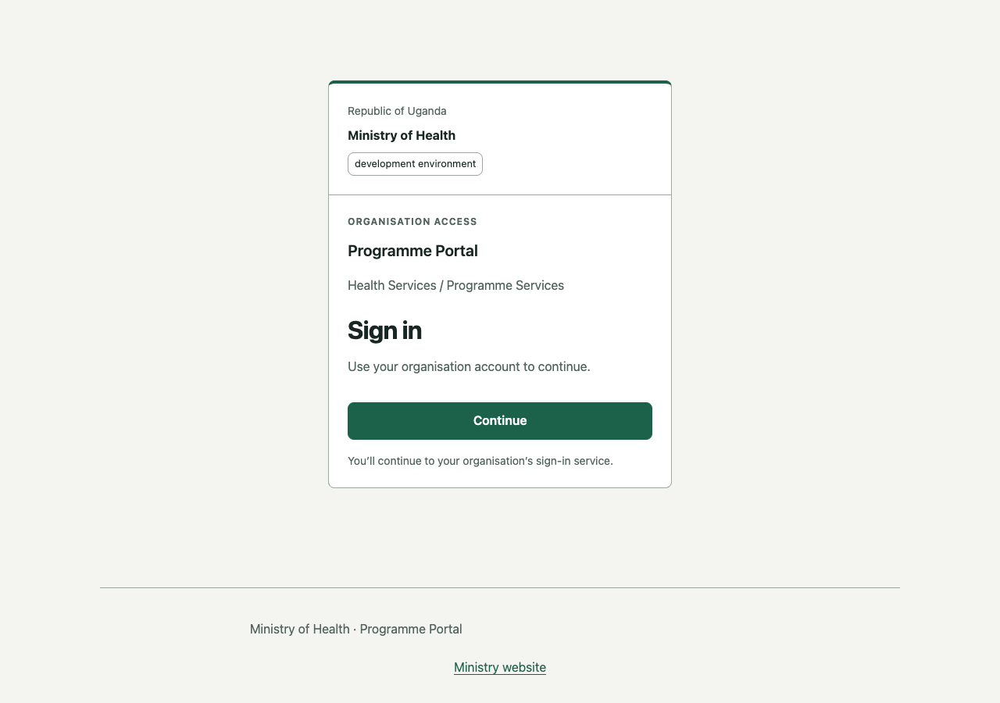
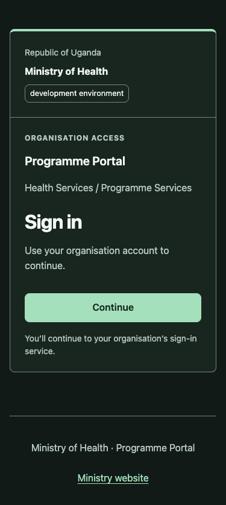

# Shared client login design

React, Vanilla JavaScript and Flutter use the same sign-in structure, copy and layout
contract. It lives in `templates/shared/identity/login.json` in the Foundry repository.
Generation writes a reference at `identity/login-design.json`, web bindings at
`src/shared/identity/login.json`, and Flutter constants at
`packages/foundation_identity/lib/src/login_design.dart`. Change the source contract
when changing the design; do not independently tune its generated copies.

The design uses a centred card (maximum 440 logical pixels), 24-pixel internal padding,
a 48-pixel minimum primary action, and a 32-pixel sign-in title. Organisation identity,
optional approved images, product name, department/programme, and environment label
appear before the action. Public/support links remain in the footer. Authentication
loading, pending and error states use this same card; pending actions are disabled,
and errors/status changes have accessible announcements. Compact screens scroll,
large text wraps, and web clients provide keyboard focus and a skip link. The login
shell hides application navigation until the application is authenticated.

Colours, fonts, borders, corner radius and optional assets use the existing identity
profile, including light/dark tokens. No approved Ministry logos or fonts have been
supplied: neutral defaults remain pending approval. Keep a common reviewed Ministry
identity source for each generated application to preserve branding across products.
Platform text rendering follows native font metrics; approved custom fonts must be
registered in each platform before expecting identical typography.

## Client integration

Generated OIDC-enabled applications already select the login appearance. Reuse it
when composing a custom client:

```jsx
<IdentityShell authentication>
  <IdentitySignIn onSignIn={startSignIn} pending={pending} error={safeMessage} />
</IdentityShell>
```

Vanilla JS uses `createIdentityState('sign-in', { onAction, pending, error })` (or
`createIdentitySignIn`) and passes `{ authentication: true }` as the third argument
to `createIdentityShell(content, profile, options)`. Call destroy/unsubscribe when
replacing views. Flutter uses `IdentityShell(authentication: true, identity: profile,
child: IdentitySignIn(identity: profile, onSignIn: startSignIn, pending: pending,
error: safeMessage))`. The existing generic loading/error components remain available
for non-authentication screens. Supplying no action callback disables Continue.

Continue invokes the existing OIDC adapter and opens the provider sign-in service.
Credentials are entered on that service; authentication policy and password handling
stay with the provider. Disabling OIDC still leaves the original application home
available. Go and Rust remain backend/CLI foundations; they carry the shared design
reference and provider-theme bundle rather than adding a graphical client.

## Provider-hosted credentials: Keycloak

Every generated foundation includes `auth/keycloak-theme/foundry/login`. This directory
is generated and rewritten by identity sync; put custom extensions in a separate child
theme or update the shared Foundry sources for all clients. This theme
inherits `keycloak.v2` and changes CSS, public identity messages, and optional image
resources. It preserves Keycloak's credential form, form actions, MFA, social login,
recovery, translations and validation. It shares the client card dimensions, palettes,
typography, focus treatment and button styling. The credential action says Sign in;
the client gateway says Continue because it opens the provider page.

Deploy the generated `foundry` directory under `/opt/keycloak/themes/foundry`, then
select **foundry** as the realm Login theme under Realm settings → Themes. Client
login-theme overrides can select the same theme. The bundled disposable development
realm already selects it, and `auth/dev/compose.yaml` mounts the generated directory.
For an existing realm, select the theme explicitly; imports do not overwrite existing
realm settings. In production, package/mount the theme through the normal deployment
pipeline and refresh the provider's theme caches/restart after updating it.

The provider theme contains organisation-wide branding, so a shared realm does not
show an unrelated application's hard-coded product name. For distinct programme
brands, deploy separate named theme directories and assign the appropriate realm or
client override. UI hooks target Keycloak 26.8.1 / keycloak.v2; check form rendering
when upgrading Keycloak. Styling supports light/dark preference and reduced motion.
Only English heading/button messages are overridden; other locale message bundles
continue to inherit the provider's translations.

Other OIDC providers need their own hosted-page branding integration. OIDC standardises
authentication, not hosted-page design; a client cannot force a provider to load this
CSS. The application gateway stays consistent regardless of the selected provider.

## Updates and checks

Edit `identity/identity.json` and run `foundry identity sync --dry-run`, then sync to
regenerate public identity, design bindings, provider tokens, and approved assets.
Deploy/rebuild both client and theme. Sync leaves editable client layout source alone:
earlier projects must adopt the updated components/app wiring before they gain this
layout. Generated design files are outputs; runtime JSON edits do not update code
without synchronization and rebuilds. Sync retains unused old assets for manual review.

Foundry tests guard the shared web/Flutter constants and provider metrics and escape
organisation text in provider HTML. Web tests cover callback wiring, pending/error
states, navigation visibility and teardown. Flutter tests cover small-screen scrolling
at 200% text scale and shell changes through authentication states. The real Keycloak
CI fixture also requests the credential page and checks that the theme and inherited
form action render. Browser visual QA compares React and Vanilla JS at desktop/mobile
sizes in light/dark, pending and error states.

## Reference previews

These screenshots show neutral defaults and example programme details. React and
Vanilla JS render the same card metrics and colours in these scenarios.





The Foundry repository's optional `node scripts/check-login-theme.mjs` check requires
the running disposable provider, Node, Playwright and Chrome. Set
FOUNDRY_PLAYWRIGHT_PACKAGE to the absolute installed Playwright package.json,
FOUNDRY_CHROMIUM_EXECUTABLE to Chrome's executable, and FOUNDRY_LOGIN_SCREENSHOTS to
the output folder. `--help` describes these inputs. It requests a login page without
entering credentials, verifies responsive card/control dimensions, and writes two
screenshots. Only its fixed loopback test-provider context accepts the disposable
self-signed certificate. CI publishes the images as keycloak-login-preview artifacts.
